# Builtglory Web App — workflows

End-to-end flows across the web app (W) and the backend API (API). Each flow lists the calls in order, what the backend must do, and which back-office (admin) action moves it to the next stage. Diagrams are Mermaid (render on GitHub / most Markdown viewers).

Related files: `API_CALLS_AND_CONTRACTS.md` (request/response shapes), `LOGIC_AND_FUNCTIONALITY.md` (screen rules).

---

## 1. Session

### 1.1 Restore on page load

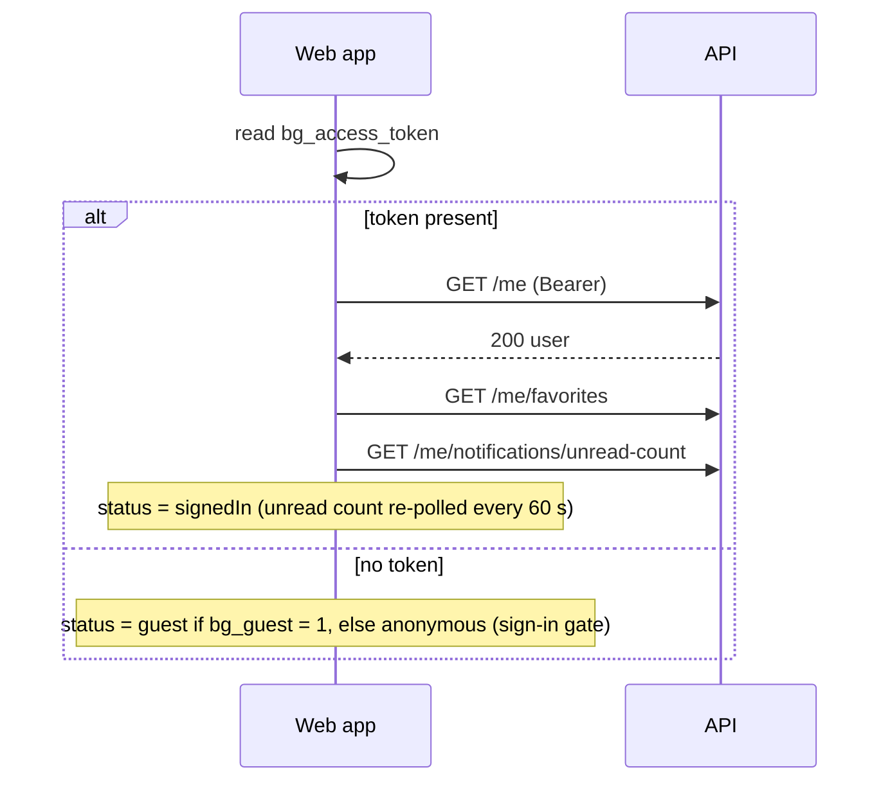

### 1.2 Expired access token

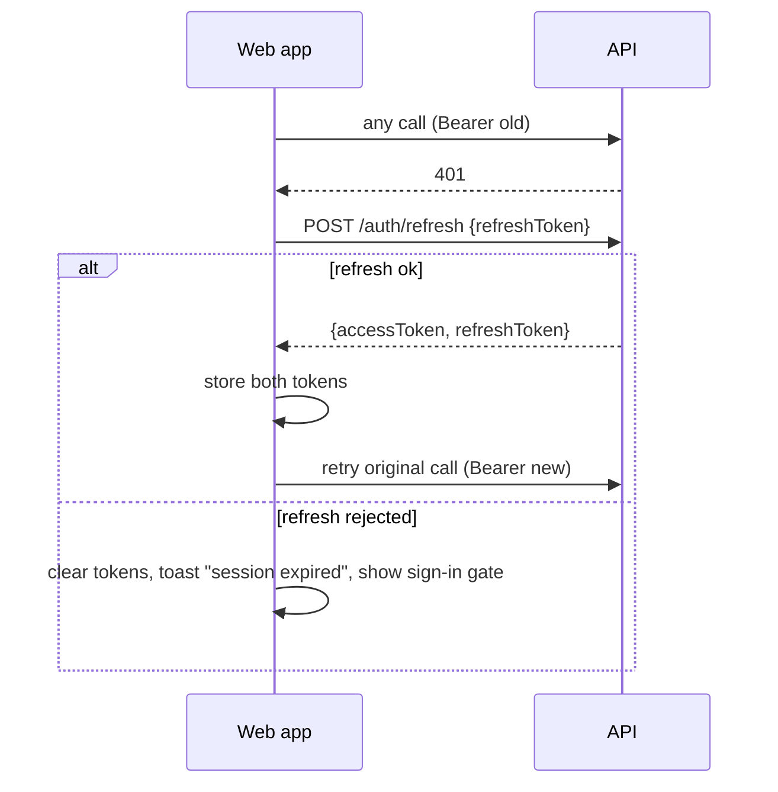

Backend must: return 401 (not 403) for expired/invalid access tokens; rotate refresh tokens safely (the web sends at most one refresh at a time).

### 1.3 Log out

`POST /auth/logout {refreshToken}` (Bearer) → clear tokens and guest flag → Home with sign-in gate. Errors are ignored.

---

## 2. Sign in, sign up, onboarding

### 2.1 Log in with OTP

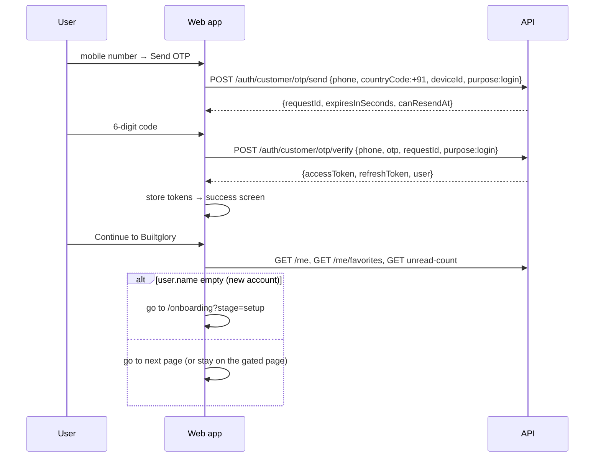

Backend must: create the customer on first successful verify (role `buyer`, userType `resident`); enforce resend cooldown (409 with a readable message); 6-digit OTP.

### 2.2 Sign up

Same as 2.1, started from the Sign up tab. After verify and before the success screen:

`PATCH /me { name, email, role, userType }` (Buyer → buyer/resident, Seller → seller/resident, NRI → buyer/nri).

The password typed on the form is **not sent** (no password support in the API).

### 2.3 Onboarding

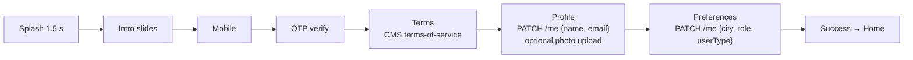

Already signed in: `/onboarding?stage=setup` or `?stage=prefs` starts at F or G.

### 2.4 Guest

"Continue as Guest" → `bg_guest = 1`. Any account action opens "Sign in to continue" → `/login?mode=login|signup&next=<current page>`.

---

## 3. Buyer journey

### 3.1 Discover

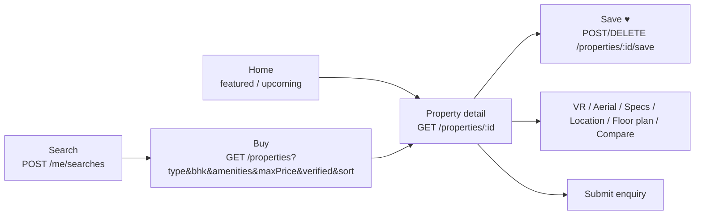

### 3.2 Enquiry → visit → deal

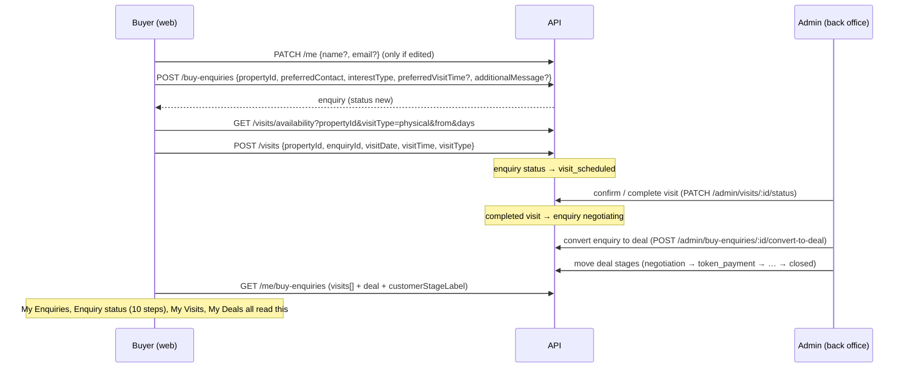

Backend must: return each enquiry **enriched with `visits[]` (by `enquiryId`) and `deal`** — the web has no other source for visits and buyer deals.

### 3.3 Reschedule / cancel a visit

- Reschedule: My Visits → `/properties/:pid/visit?enquiryId&visitId&type` → availability → `PATCH /visits/:id/reschedule {visitDate, visitTime}`.
- Cancel: My Visits → confirm → `PATCH /visits/:id/cancel {reason}` → reload `GET /me/buy-enquiries`.

### 3.4 Cancel an enquiry

Allowed in the UI only while active and without a deal → `PATCH /me/buy-enquiries/:id/cancel` → status `closed` (shown as "cancelled").

### 3.5 NRI video tour

`GET /visits/availability?visitType=virtual&from=<tomorrow>&days=14` → choose day (first 5 open days) and time → `POST /visits {visitType:"virtual", enquiryId?}`. Appears in My Visits only when linked to an enquiry.

### 3.6 Buyer status transitions the UI expects

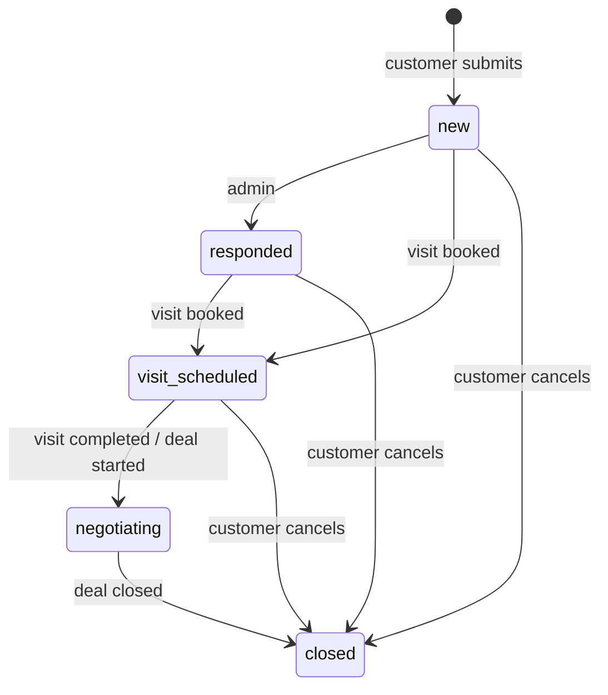

Deal stages (admin-driven): `active_leads → site_visits → negotiation → token_payment → full_payment | stage_payment → interior_design → documentation → closed` (`lost`, `re_engagement` side states).

Visit statuses: `scheduled → confirmed → completed`; `scheduled|confirmed → rescheduled` (customer); `→ cancelled` (customer or admin); `→ missed` (admin).

---

## 4. Seller journey

### 4.1 List a property (sell wizard)

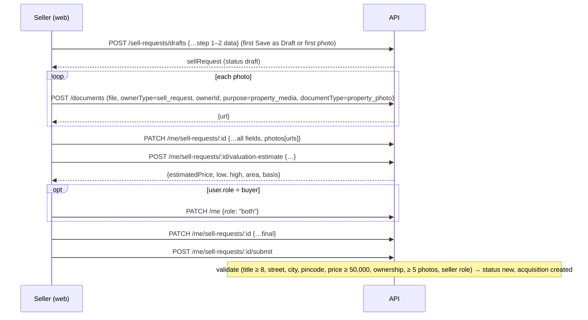

### 4.2 Verification → offer → negotiation

```mermaid
sequenceDiagram
  participant S as Seller (web)
  participant API
  participant A as Admin (back office)
  A->>API: review sell request (under_review / accepted / approved / changes_requested / rejected)
  A->>API: acquisition stage: pending_review → site_inspection → valuation
  A->>API: set builtgloryOffer (+ negotiation.deadline)
  S->>API: GET /me/sell-requests/:id/activity
  API-->>S: offer {amount, expiresAt}
  alt seller accepts
    S->>API: POST …/offer-decision {decision: accepted}
    Note over API: negotiation.status seller_accepted; stage negotiation → token_to_seller
  else seller counters
    S->>API: POST …/offer-decision {decision: countered, counterAmount, notes}
    Note over API: negotiation.status seller_countered; stage → negotiation
    A->>API: revise offer (back office)
  end
```

### 4.3 Deal → payout → registration → sold

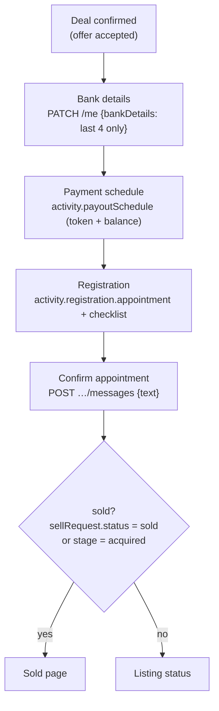

Admin actions that move this part: acquisition `token` (amount, paid), `documentation` (`registrationAppointment {date, time, office, address}`, `requiredDocuments`, `registrationStatus`), stage `documentation → seller_payout → acquired`, seller payout payments (`type: seller_payout`, status `paid`), and sell request status `sold`.

### 4.4 Seller status the UI expects

Sell request: `draft → new → under_review → accepted | approved → active → negotiating → sold`, side states `changes_requested`, `paused`, `rejected`.

Acquisition stage: `pending_review → site_inspection → valuation → negotiation → token_to_seller → documentation → seller_payout → acquired` (`rejected`, `on_hold`).

Listing card groups: Active / Sold / Withdrawn (`paused`, `rejected`) / drafts (under "All").

---

## 5. Support

### 5.1 Live chat

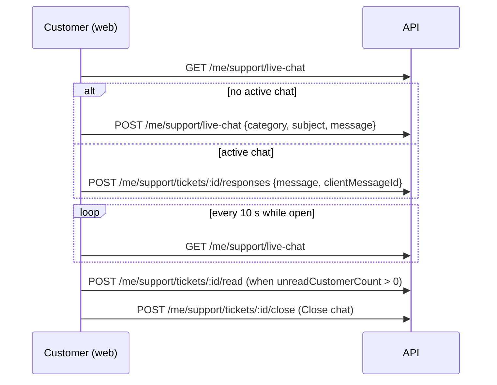

### 5.2 Ticket

Optional screenshot `POST /documents (ownerType=user, purpose=support_attachment)` → `POST /support/tickets {category, subject, message, attachments, channel:ticket}` → Ticket detail (`GET` every 10 s while open) → reply / Mark as resolved (`close`) / Reopen.

### 5.3 Callback

Customer support → Request a callback → `POST /callbacks {source: help_support, sourceScreen, category: general, bestTimePreference}` → "We'll call you in your chosen slot."

---

## 6. Notifications

1. Backend creates in-app notifications (`channel: in_app`) for workflow events (enquiry created, visit scheduled/confirmed/rescheduled/cancelled, sell request status changes, offer, payments, deal stages, support replies).
2. Web polls `GET /me/notifications/unread-count` every 60 s → sidebar badge and header dot.
3. Notifications page: `GET /me/notifications?limit=100`; open one → `PATCH /me/notifications/:id/read` → navigate by `enquiryId` / `listingId` / `propertyId` / `dealId` / event keywords; "Mark all read" → `PATCH /me/notifications/read`.

Backend should fill `title`, `message` and the most specific id (`enquiryId`, `listingId`, `propertyId`, `dealId` or `entityType` + `entityId`) so taps open the right screen.

---

## 7. Account

### 7.1 Change phone

`POST otp/send {phone: new, purpose: change_phone}` → `POST otp/verify {purpose: change_phone}` → `{verified: true}` → `PATCH /me {mobileNumber}` → updated user.

### 7.2 Notification preferences

Each toggle → `PATCH /me {notificationPreferences: {push, whatsapp, sms, email, in_app}}` with **all five channels** (the backend replaces the whole object).

### 7.3 Delete account

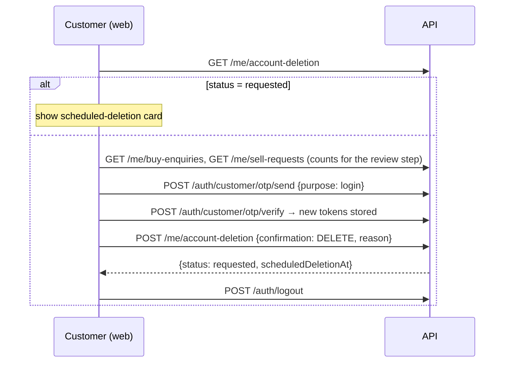

---

## 8. Back-office actions the web app depends on

The web app is customer-only. These admin/back-office actions are required for the customer screens to progress:

| Customer screen | Needs the backend/admin to… |
| --- | --- |
| Home → Featured / Upcoming | set `isFeatured` / `isUpcoming` (+ `launchDate`) on visible properties |
| Verified badge | set property `status: available` |
| Enquiry pipeline | move enquiry status, convert to deal, move deal stages, verify KYC |
| My Visits | confirm / complete / mark missed |
| Listing pipeline | review sell request, create/move acquisition stages, set offer amount and deadline |
| Payment schedule | set token amount/paid, create seller payout payments |
| Registration | set `documentation.registrationAppointment`, checklist, registration status |
| Sold | set sell request `sold` or acquisition `acquired` |
| Help / Legal / About | publish CMS content (`faq` with `metadata.icon` + `topicLabel`, `legal` slugs `terms-of-service` / `privacy-policy`, `about`) |
| Support | reply to tickets and live chats |
| Notifications | emit in-app notifications on each workflow change |
